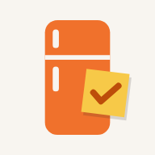

<p align="center"></p>

<h1 align="center">おかって</h1>

<p align="center">家族で使う、冷蔵庫リストと買い物リストとレシピ帳。<br>Claude や ChatGPT から、話しかけるだけで動かせます。</p>

<p align="center"><a href="https://deploy.workers.cloudflare.com/?url=https://github.com/SogoKato/okatte"></a></p>

「お勝手」は台所の古い言い方です。勝手口から人が出入りするように、あなたのアシスタントが裏口からリストを読み書きします。

おかっては、自分の家族のために自分でデプロイして使う（セルフホストする）Web アプリです。データはあなたの Cloudflare アカウント（またはあなたのサーバー）の中だけに置かれます。

## できること

**リスト**
- 冷蔵庫（と台所）にあるものと、買い物リスト。家にいる人が更新し、スーパーにいる人が見る、を家族で共有できます
- チェックした買い物を、まとめて冷蔵庫へ移せます
- 他の端末やアシスタントの変更は、20 秒ごとと、画面に戻ったときに反映されます

**レシピ**
- 料理名、出典（URL や本）、タグ、メモで残せます
- 「作った」を記録して、何をいつ作ったか振り返れます

**アシスタント連携（MCP）**
- Claude や ChatGPT に URL を 1 つ登録するだけでつながります（OAuth 2.1。アプリ側での事前登録は不要）
- 「レシートの写真から冷蔵庫に入れて」「冷蔵庫にあるもので献立を考えて」「最近作ってないレシピは？」のように頼めます
- 接続ごとに「閲覧のみ」を選べ、設定画面からいつでも解除できます。家族の管理やパスキーには、アシスタントからは触れません

**家族とログイン**
- パスキーだけでログインします（パスワードはありません）
- 管理者が招待リンクを作り、家族はそれぞれの端末でパスキーを登録します
- スマホのホーム画面に追加して、アプリのように使えます（PWA）

## Cloudflare にデプロイする

Cloudflare の無料プラン（Workers と D1）で、1 家族の利用には十分に収まります。必要なのは Cloudflare のアカウントと、GitHub のアカウントです。

### ボタンでデプロイする

1. 上の **Deploy to Cloudflare** ボタンを押します。
2. Cloudflare のセットアップ画面で、次を決めます。
   - **Git account**: GitHub を選びます。あなたの GitHub に、このリポジトリの複製が作られます。
   - **Project name**: 例 `okatte`。リポジトリ、Worker、データベースの名前になり、アプリの URL は `https://okatte.あなたのサブドメイン.workers.dev` になります（サブドメインは、ダッシュボードの「Workers & Pages」の右側に表示されています）。
   - **D1 データベース**: 「Create new」のまま、新しく作ります。
   - **`SETUP_TOKEN`**: 最初の管理者を作るときの合言葉です。長めの文字列にして、控えておいてください。
   - **Enable Preview builds**: オフにします。オンのままだと、`main` 以外のブランチへの push でプレビュー版がデプロイされ、同じデータベースを使うためです。
3. 「Deploy」を押し、終わったら表示された URL を開きます。データベースの準備は、最初のアクセスで自動的に行われます。
4. 「最初の設定」に進みます。

### 手でデプロイする

ボタンを使わない場合や、手元から操作したい場合です。Node.js 24 以上と pnpm が必要です。

```sh
git clone https://github.com/SogoKato/okatte.git
cd okatte
pnpm install
npx wrangler login
pnpm run deploy
```

`pnpm run deploy` で、Worker と D1 データベースが作られ、URL が表示されます。最初の管理者を作る前に、ダッシュボードで Worker を開き、「Settings」→「Variables and Secrets」に `SETUP_TOKEN`（種類は Secret、値は合言葉）を追加してください。コマンドなら `npx wrangler secret put SETUP_TOKEN` です。

### 独自ドメインを使う

ダッシュボードで Worker を開き、「Settings」→「Domains & Routes」→「Add」→「Custom domain」で、Cloudflare で管理しているドメイン（例 `lists.example.com`）を追加します。

**パスキーとログインは、開いたドメインごとに分かれます**（データは共通です）。`workers.dev` で登録したパスキーは、独自ドメインでは使えません。使うドメインを 1 つに決めて、家族がパスキーを登録する前に、そのドメインを `PUBLIC_URL`（例 `https://lists.example.com`）として「Variables and Secrets」に設定してください。`PUBLIC_URL` を設定すると、ほかのドメインで開いたときは、ログインやアシスタントの接続ができなくなります。

### 1 つのアカウントに複数の家を建てる

実家用などに、もう 1 つ建てる場合は、Worker とデータベースを別の名前にします。同じ名前のままデプロイすると、上書きしたり同じデータベースを共有したりしてしまいます。

```sh
cp wrangler.jsonc wrangler.parents.jsonc   # wrangler.*.jsonc は Git の管理外
# wrangler.parents.jsonc の "name" と "database_name" を、例えば okatte-parents に変える
pnpm build && npx wrangler deploy -c wrangler.parents.jsonc
```

`SETUP_TOKEN` は、新しい Worker のほうに設定します。

## 最初の設定

1. アプリの URL を開くと、セットアップ画面が出ます。
2. 家の名前、あなたの名前、`SETUP_TOKEN` を入力し、この端末のパスキーを登録します。あなたが管理者になります。
3. 「設定」→「家族を招待するリンクを作る」で招待リンクを作り、家族に渡します（7 日間、1 回だけ使えます）。家族はリンクを開いて、自分の端末でパスキーを登録します。
4. スマホでは、ホーム画面に追加しておくと便利です。
   - iPhone: Safari で開き、共有ボタン →「ホーム画面に追加」
   - Android: Chrome で開き、メニュー →「ホーム画面に追加」または「アプリをインストール」

## アシスタントとつなぐ

「設定」→「Claude や ChatGPT とつなぐ」に、頼み方の例と、Claude と ChatGPT それぞれのつなぎ方があります。

つなぐ URL は、アプリの URL の後ろに `/mcp` を付けたもの（例 `https://okatte.example.workers.dev/mcp`）です。

- **Claude**: 設定の「コネクタ」で「カスタムコネクタを追加」を選び、名前（家の名前など）と URL を入れます。
- **ChatGPT**: ブラウザで ChatGPT を開き、プラグインの画面で「追加」→「カスタム MCP サーバーを追加」を選び、「サーバーURL」に入れます（ChatGPT のスマホアプリからは追加できません）。

どちらも、追加するとおかってのログインと同意の画面が開くので、パスキーでログインして許可します。

## 更新する

新しい版は [Releases](https://github.com/SogoKato/okatte/releases) で公開します。リポジトリの「Watch」→「Custom」→「Releases」を選ぶと、公開のたびに GitHub から通知が届きます。データベースの変更は、新しい版の最初のアクセスで自動的に当たるので、コードを入れ替えるだけで更新できます。

**ボタンでデプロイした場合**、あなたの GitHub のリポジトリに変更を取り込むと、Cloudflare が自動でデプロイします。

```sh
git clone https://github.com/<あなた>/okatte.git
cd okatte
git remote add upstream https://github.com/SogoKato/okatte.git
git pull upstream main
git push
```

**手でデプロイした場合**:

```sh
git pull
pnpm install
pnpm run deploy
```

前の版と互換がなくなる変更があるときは、リリースノートの先頭に書きます。

## 設定（環境変数）

Cloudflare では Worker の Variables and Secrets、Node では環境変数で設定します。

| 名前 | 必須 | 内容 |
|---|---|---|
| `PUBLIC_URL` | Node のみ必須 | アプリを開く URL（パスなし）。https のみ（localhost は http も可）。Cloudflare では、設定しなければ開いた URL をそのまま使い、設定するとそのドメインだけで使えます |
| `SETUP_TOKEN` | 強く推奨 | 最初の管理者を作るときの合言葉。設定しないと、最初にアクセスした人が管理者になります |
| `APP_NAME` | | パスキーの登録画面に出る名前。既定は「おかって」 |
| `OAUTH_CLIENTS` | | 自分で登録できないアシスタント用の、事前登録クライアント。JSON の配列 `[{"clientId", "name", "redirectUris": [...]}]` |
| `DATABASE_PATH` | | Node のみ。SQLite のファイル。既定は `./data/app.db` |
| `PORT` | | Node のみ。既定は `8787` |
| `WEB_DIR` | | Node のみ。ビルドした画面の場所。既定は `./dist/web` |

## Node で動かす

Cloudflare を使わず、自分のサーバーで動かすこともできます。データは SQLite のファイルに入ります。

```sh
pnpm install
pnpm build
PUBLIC_URL=https://lists.example.com SETUP_TOKEN=... pnpm start
```

パスキーとアシスタント連携には https が必要なので、外から使うときは、リバースプロキシ（Caddy や nginx など）で https にしてください。

## 困ったとき

- **画面にエラーが出て使えない / ログインできない**: `PUBLIC_URL` を設定している場合は、実際に開いている URL と同じかを確かめてください。Worker のログ（ダッシュボードの「Logs」）に原因が出ます。
- **家族が端末をなくした / 機種変更した**: 他の端末でログインできれば、「設定」でパスキーを追加・削除できます。全ての端末を失った場合は、管理者が「設定」→「家族」でその人の「パスキー再登録のリンク」を作ります。古いパスキーとログインはすべて無効になります。
- **アシスタントが新しい機能を使わない**: Claude や ChatGPT は、つないだ時点の機能の一覧を覚えています。アシスタント側のコネクタの設定で、更新（再読み込み）してください。

## 開発

```sh
pnpm install
pnpm dev   # Workers と D1 を手元で動かす（http://localhost:8787）
```

画面を作りながら確かめるときは、`PUBLIC_URL=http://localhost:5173 pnpm start`（API）と `pnpm dev:web`（画面、http://localhost:5173）を並べて動かします。

| コマンド | 内容 |
|---|---|
| `pnpm typecheck` | 型チェック |
| `pnpm test` | 単体テストと結合テスト（実際の SQLite を使う） |
| `pnpm test:browser` | ブラウザでの E2E テスト（Playwright、`pnpm build` の後に） |
| `pnpm e2e` | HTTP での E2E テスト（OAuth と MCP の流れ） |
| `pnpm gen` | MCP のツール一覧とマイグレーションを、コードに埋め込み直す（ツールやスキーマを変えた後に） |

設計の考え方や決めたことは [docs/design.md](docs/design.md) にあります。技術は TypeScript、Hono、React（Vite）、Drizzle、SQLite（Cloudflare では D1）、WebAuthn です。

## ライセンス

[MIT](LICENSE)
